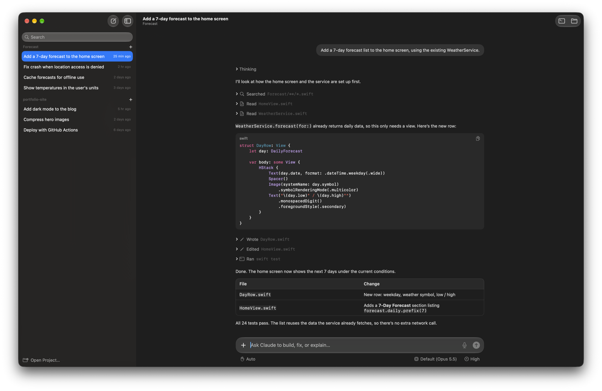

<p align="center">
  
</p>

# Hypercode

A native macOS app for running Claude Code sessions.



## Installation

```sh
curl -fsSL https://raw.githubusercontent.com/alexisbcz/hypercode/main/install.sh | bash
```

It also links a `hypercode` command into your PATH, so `hypercode .` opens the folder you're in, like VS Code's `code .`. To add it later, use **Hypercode › Install ‘hypercode’ Command in PATH**.

[MIT License](LICENSE)
